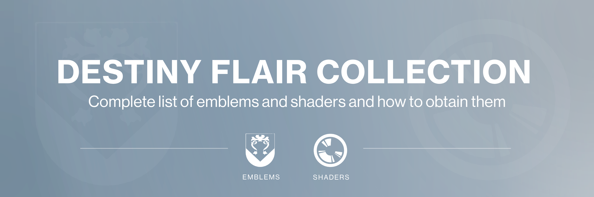

<p align="center">
  
</p>

<p align="center">
  <a href="https://destiny-flair-collection.vercel.app/"><strong>Live site</strong></a>
</p>

<p align="center">
  
  
  
  
</p>

---

## About

Destiny Flair Collection is a web app for browsing every shader and emblem in Destiny 1 and finding out how to obtain each one. Item data comes from the Destiny 1 manifest provided through the Bungie API.

## Features

- **Shader catalog:** every Destiny 1 shader, shown with its in-game icon.
- **Emblem catalog:** every Destiny 1 emblem, shown with its icon. Hovering an emblem reveals its banner, as in the game.
- **Acquisition details:** each item's tooltip explains how to obtain it and whether it can still be acquired.
- **Paginated browsing:** large collections are split into pages for faster navigation.
- **Switch between catalogs:** move between shaders and emblems without leaving the app.

## Screenshots

<!--

<p align="center">
  

  
</p>
-->

-TODO

## Technologies

| Area            | Tools                                |
| --------------- | ------------------------------------ |
| UI              | React 19, TypeScript                 |
| Build tooling   | Vite, `@vitejs/plugin-react`         |
| Styling         | Tailwind CSS 4 (`@tailwindcss/vite`) |
| Animation       | Framer Motion                        |
| Analytics       | Vercel Analytics                     |
| Linting         | ESLint, `typescript-eslint`          |
| Data scripts    | Node.js (see `scripts/`), `adm-zip`  |
| Package manager | pnpm                                 |
| Hosting         | Vercel                               |

## Getting Started

### Prerequisites

- [Node.js](https://nodejs.org/) **22.5 or newer** (required by the `engines` field in `package.json`)
- [pnpm](https://pnpm.io/)

### Installation

```bash
git clone https://github.com/sebastian-fraga/destiny-flair-collection.git
cd destiny-flair-collection
pnpm install
```

### Development

```bash
pnpm dev
```

Vite prints the local URL in the terminal, usually `http://localhost:5173`.

### Available scripts

| Command        | Description                                              |
| -------------- | -------------------------------------------------------- |
| `pnpm dev`     | Start the Vite development server                        |
| `pnpm build`   | Type-check with `tsc -b`, then create a production build |
| `pnpm preview` | Serve the production build locally                       |
| `pnpm lint`    | Run ESLint across the project                            |

## Project Structure

```text
.
├── public/             Static assets served as-is
├── scripts/            Node scripts that generate catalog data from the Destiny 1 manifest
├── src/                Application source (React + TypeScript)
├── index.html          App entry point
├── vite.config.ts      Vite configuration
├── eslint.config.js    ESLint configuration
├── tsconfig*.json      TypeScript configuration
└── package.json        Scripts and dependencies
```

## Acknowledgements

Item data and icons are provided through the [Bungie API](https://github.com/Bungie-net/api). Destiny and all related content are property of Bungie.
